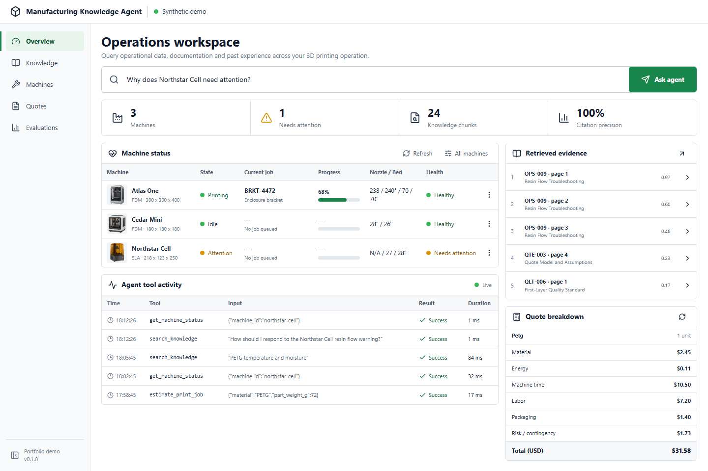
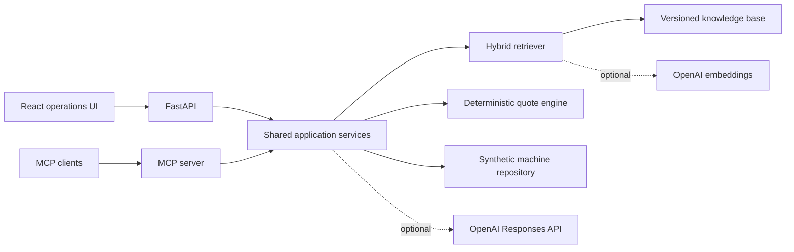
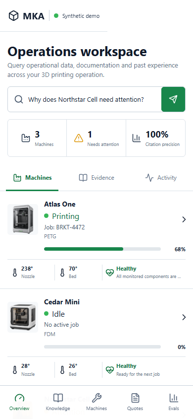

# Manufacturing Knowledge Agent

[English / README principal](README.md) · Português (Brasil)

[](https://github.com/santosgus3dtech/manufacturing-knowledge-agent/actions/workflows/ci.yml)
[](https://www.python.org/)
[](https://modelcontextprotocol.io/)
[](LICENSE)

Um ambiente de trabalho de RAG e Model Context Protocol adequado para portfólio, voltado a pequenas operações de manufatura. Ele reúne busca de conhecimento fundamentada em fontes, telemetria sintética de máquinas, orçamentação determinística de trabalhos e avaliação da recuperação de informações em um único serviço FastAPI e uma interface operacional em React.

> Todas as máquinas, trabalhos, documentos e eventos deste repositório são fictícios. Não há informações de clientes, credenciais de produção ou detalhes de infraestrutura em operação.



## O que demonstra

- **RAG fundamentado em fontes:** recuperação lexical híbrida com expansão de vocabulário de manufatura, embeddings opcionais da OpenAI e citações que podem ser inspecionadas.
- **Integração MCP:** ferramentas tipadas, recursos e um prompt reutilizável de triagem de incidentes sobre os mesmos serviços da aplicação.
- **Lógica de negócio confiável:** a orçamentação determinística baseada em `Decimal` permanece separada da saída generativa.
- **Avaliação:** um conjunto de dados versionado informa Recall@3 e a média do posto recíproco para alterações na recuperação de informações.
- **Visão de produto:** interface operacional responsiva, saúde das máquinas, rastros de ferramentas, inspeção de evidências e controles de orçamento.
- **Boas práticas de portfólio:** dados de teste sintéticos, modo local de contingência, configuração que protege segredos, testes, CI e suporte a Docker.

## Arquitetura



As interfaces da API e do MCP compartilham uma camada de serviços, mantendo consistentes os resultados de busca, os orçamentos e o estado das máquinas entre os clientes. Sem uma chave de API, o projeto funciona inteiramente em modo local determinístico.

## Início rápido

### Backend

```powershell
python -m venv .venv
.\.venv\Scripts\Activate.ps1
python -m pip install -e ".\backend[dev]"
Copy-Item .env.example .env.local
uvicorn manufacturing_agent.api:app --reload
```

A API está disponível em `http://127.0.0.1:8000`; a documentação interativa fica em `/docs`.

### Frontend

```powershell
Set-Location frontend
pnpm install
pnpm run dev
```

Abra `http://127.0.0.1:5173`. O Vite encaminha as requisições `/api` para o FastAPI por proxy.

### Docker

```powershell
docker compose up --build
```

A aplicação combinada é servida em `http://127.0.0.1:8000`.

## Servidor MCP

Execute usando stdio:

```powershell
.\.venv\Scripts\python.exe -m manufacturing_agent.mcp_server
```

Ferramentas disponíveis:

| Ferramenta | Finalidade |
| --- | --- |
| `search_knowledge` | Recuperar orientações operacionais ordenadas por relevância e com citações |
| `get_machine_status` | Ler o estado sintético normalizado das máquinas |
| `estimate_print_job` | Produzir uma discriminação determinística de custos |
| `diagnose_incident` | Gerar uma avaliação de incidente fundamentada em fontes |

O servidor também expõe recursos de máquinas e materiais, além de um prompt `incident_triage`. Para usar Streamable HTTP, defina `MKA_MCP_TRANSPORT=streamable-http`; o endpoint escuta na porta `8001`.

## Interface da API

| Método | Endpoint | Descrição |
| --- | --- | --- |
| `GET` | `/api/dashboard` | Resumo operacional e da recuperação de informações |
| `GET` | `/api/machines` | Inventário sintético de máquinas |
| `GET` | `/api/knowledge/search` | Busca de conhecimento ordenada por relevância |
| `POST` | `/api/agent/ask` | Resposta fundamentada em fontes, com citações |
| `POST` | `/api/quotes/estimate` | Cálculo determinístico de orçamento |
| `GET` | `/api/evaluations` | Resultados da avaliação de recuperação de informações |
| `GET` | `/api/activity` | Rastros recentes de ferramentas |

## Verificações de qualidade

```powershell
.\.venv\Scripts\ruff.exe check backend
.\.venv\Scripts\pytest.exe backend\tests
pnpm --dir frontend run lint
pnpm --dir frontend run build
```

O conjunto de avaliação incluído no repositório cobre manutenção, materiais, qualidade, conectividade e orçamentação. Ele é intencionalmente pequeno e legível para que as alterações possam ser revisadas em uma pull request.

## Estrutura do projeto

```text
backend/                 FastAPI, MCP, retrieval, quote engine and tests
data/fixtures/           Synthetic machine state
data/knowledge/          Portfolio-safe manufacturing documents
evals/                   Retrieval evaluation dataset
frontend/                React and TypeScript operations interface
docs/design/             Generated visual direction used during implementation
docs/screenshots/        Verified desktop and mobile application captures
```

## Notas de design

A interface foi deliberadamente concebida mais como um console de operações do que como uma página de marketing: densidade de informações compacta, evidências visíveis, cores contidas e significado claro dos estados. Os estudos de design gerados são mantidos em `docs/design` para mostrar o processo do conceito à implementação.



## Licença

Licença MIT. Consulte [LICENSE](LICENSE).
